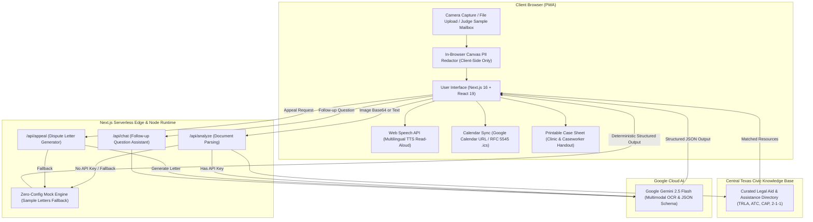

# TL;DR Mail — Decode Your Official Mail

> **AI-powered civic literacy assistant that converts confusing official letters into 6th-grade action steps, strict deadlines, and free local legal aid. Built for WarriorHacks 2.0 (Westwood CS Club, Austin, TX).**

[](https://nextjs.org/)
[](https://www.typescriptlang.org/)
[](https://tailwindcss.com/)
[](https://aistudio.google.com/)
[](https://web.dev/progressive-web-apps/)
[](LICENSE)

---

## 🚨 The Crisis: Why Official Mail Fails Everyday Families

Every day, millions of American households open their physical mailboxes to find intimidating, legalistic letters printed in dense font and filled with administrative jargon. For working families, seniors, and non-native English speakers, missing a single sentence can mean losing a home, having power cut off, or forfeiting vital healthcare.

This is especially acute across **Austin, Travis County, and Central Texas**:

* **32,000+ Eviction Filings Annually**: Over thirty-two thousand eviction cases are initiated each year across Central Texas justice courts, often precipitated by non-payment notices that tenants simply could not comprehend in time.
* **1 in 5 Adults Face Literacy Barriers**: According to the National Center for Education Statistics, roughly 21% of US adults experience low document literacy, rendering standard court notices and bureaucratic administrative appeals nearly impenetrable.
* **$180M+ Lost in Texas Benefits Annually**: An estimated $180+ million in critical SNAP food assistance and Medicaid coverage is lost statewide each year not due to disqualification, but because of **procedural errors**—missed 10-day renewal deadlines and confusing verification requests.
* **A 72-Hour Clock on Housing**: Under Texas Property Code §24.005, a standard Notice to Vacate provides families with as few as **three days (72 hours)** before a landlord can file a formal forcible detainer lawsuit.

> [!CAUTION]
> **A complex letter is not just an inconvenience—it is an emergency.** When a resident panics and hides the letter in a drawer, the default judgment or shutoff order takes effect automatically.

---

## 💡 The Solution: TL;DR Mail

**TL;DR Mail** is a zero-barrier, camera-first civic utility that empowers anyone to photograph or paste any confusing government letter, court summons, utility shutoff warning, or medical bill. Powered by **Google Gemini 2.5 Flash**, the app immediately deconstructs the document into a crystal-clear **6th-grade reading level breakdown**, isolates strict deadlines, and instantly connects the resident to free, local legal and social aid.

---

## ✨ Key Features

### 📸 Multimodal Document OCR & Parsing
Upload an image, take a live smartphone photo, or paste raw text. TL;DR Mail feeds the document into **Google Gemini 2.5 Flash** using strict, deterministic **JSON Schema output constraints** via `@google/genai`. It accurately extracts:
* **The Sender**: Who actually sent this (e.g., *Greenfield Property Management*, *Austin Energy*, *Texas HHSC*).
* **The Bottom Line (TL;DR)**: A single, jargon-free 6th-grade summary sentence.
* **The Core Demand**: What the organization wants the recipient to do.
* **Financial Stakes**: Precise balances due, late fees, and disputed dollar amounts.
* **Inaction Consequences**: The exact real-world penalty if the letter is ignored.

### 🧠 6th-Grade Reading Level Breakdown
Bureaucratic documents use intimidating phrasing like *"forcible detainer"*, *"procedural decertification"*, or *"contractual disallowance"*. TL;DR Mail translates this into conversational language that an elementary school student can follow, paired with an **interactive step-by-step checklist** (e.g., *"Step 1: Get a cashier's check today"*, *"Step 2: Deliver it to the leasing office by 5 PM"*).

### 🛡️ Client-Side Privacy Shield & In-Browser PII Redactor
Official mail frequently displays Social Security Numbers, Medicaid IDs, account numbers, and full names. TL;DR Mail features a **built-in interactive HTML5 Canvas Redaction Tool**:
* Draw blackout bars directly across sensitive numbers before submission.
* **Zero Database Retention**: TL;DR Mail requires no account creation, stores no documents in a database, and processes files ephemerally. Your data stays yours.

### ⏰ 1-Tap Calendar Deadline Sync
Never miss a 72-hour eviction response or a benefits renewal cutoff:
* **Direct Google Calendar Link**: 1-click web intent that pre-fills event title, time, and warning notes.
* **Universal RFC 5545 `.ics` Export**: Generates and downloads native calendar files compatible with Apple Calendar, Outlook, and Android.
* **Triple-Stage Alarms**: Automatically sets embedded reminder notifications at **3 days before**, **1 day before**, and **2 hours before** the deadline.

### ⚖️ Auto-Drafted Response & Dispute Letter Generator
When faced with an erroneous bill or predatory notice, regular citizens rarely know how to write a formal legal dispute. With one click, TL;DR Mail drafts a tailored, ready-to-mail response letter citing relevant consumer statutes:
* **Tenant Defense**: Texas Property Code §24.005 & repair remedy demands.
* **Medical Billing**: Emergency care protections and EMTALA / Texas Surprise Billing laws.
* **Debt Collection**: Fair Debt Collection Practices Act (FDCPA) §1692g debt validation notices.
* Includes address blocks, placeholders (`[YOUR NAME]`), and a 1-click copy button.

### 📍 Hyper-Local Central Texas Aid Matcher
Instead of generic national hotlines, TL;DR Mail maps the parsed category directly to verified, free and low-cost organizations serving Austin and Travis County:
* **Texas RioGrande Legal Aid (TRLA)** — Free tenant eviction defense & civil legal assistance.
* **Austin Tenants Council** — Fair housing counseling and lease dispute negotiation.
* **Austin Energy Customer Assistance Program (CAP)** — Utility discount and emergency Plus-1 payment aid.
* **Texas Health and Human Services (2-1-1 / YourTexasBenefits)** — SNAP and Medicaid renewal hotlines.
* **Travis County Health & Human Services** — Emergency utility and MAP healthcare coverage.
* **Lone Star Legal Aid & Central Texas Food Bank** — Food security and consumer protection.

### 🌐 5 Languages & Voice Read-Aloud (TTS)
Austin's community is richly diverse. TL;DR Mail natively supports:
* **English** (`en`)
* **Español / Spanish** (`es`)
* **Tiếng Việt / Vietnamese** (`vi`)
* **中文 / Chinese** (`zh`)
* **العربية / Arabic** (`ar`)

Integrated with the browser's native **Web Speech API**, users can press the speaker button to hear the summary and action steps read aloud in their chosen language—critical for users with visual impairments or limited literacy.

### 🖨️ Clean 1-Page Printable Case Sheet
Caseworkers, legal aid attorneys, and community clinics need structured physical summaries. TL;DR Mail includes an optimized print view (`@media print`) that formats the letter analysis, deadlines, financial amounts, and checklist into a clean, 1-page physical case intake sheet.

### 📬 Built-in Judge Demo Mailbox
Hackathon judges can test the full functionality in under 10 seconds without needing to photograph physical letters. Click any of the **4 pre-loaded realistic letters**:
1. 🏠 **3-Day Notice to Vacate** (Travis County eviction warning under Texas Property Code §24.005)
2. ⚡ **Austin Energy Final Disconnection Notice** (Utility shutoff warning with $340.10 past due)
3. 📋 **Texas HHSC SNAP / Medicaid Renewal** (Mandatory interview notice with benefit loss warning)
4. 🏥 **St. David's Hospital Emergency Bill** ($2,185 balance with prior-authorization insurance denial)

---

## 🏗️ Architecture & Data Flow



---

## 🏆 WarriorHacks 2.0 Judging Criteria Alignment

| Criteria | Hackathon Expectation | How TL;DR Mail Delivers |
| :--- | :--- | :--- |
| **🎯 Impact** | Meaningful problem with clear audience and community value | Directly addresses the 32,000+ Austin eviction filings and $180M+ lost Texas SNAP benefits. Empowers vulnerable residents who cannot afford private legal counsel to preserve their shelter, power, and healthcare. |
| **⚙️ Feasibility** | Achievable, production-deployable, and operationally resilient | Zero backend database infrastructure required. Ships with a **resilient dual-mode engine**: executes live with Gemini 2.5 Flash when an API key is present, and gracefully operates offline via curated deterministic mocks if unconfigured. |
| **🎨 User Experience** | Intuitive, accessible, friction-free interface | **Zero-login onboarding** (no email or password required). Camera-first mobile responsive layout, multilingual translation in 5 top Texas languages, integrated text-to-speech audio player, and a 1-tap print sheet for caseworkers. |
| **💻 Technical Craft** | Elegant architecture, rigorous API design, and data privacy | Employs Google's latest `@google/genai` SDK with strict `responseJsonSchema` validation to guarantee 100% structured JSON types. Features an in-browser client-side HTML5 Canvas for redaction of sensitive PII before transmission. |

---

## 🛠️ Tech Stack

| Layer | Technologies | Rationale |
| :--- | :--- | :--- |
| **Framework** | **Next.js 16 (App Router)** | Ultra-fast Server Components, optimized client hydration, and serverless API route handlers. |
| **Language** | **TypeScript 5.0** | End-to-end type safety across Gemini response schemas, calendar generation, and state. |
| **Styling** | **Tailwind CSS v4** | Rapid utility-first styling with custom print stylesheets (`@media print`) and responsive layouts. |
| **AI Engine** | **Google Gemini 2.5 Flash** | Sub-second multimodal OCR and comprehension with guaranteed JSON schema conformity. |
| **SDK** | **`@google/genai` v2.27+** | Google's newest official unified AI SDK for Gemini models. |
| **Icons & Motion** | **Lucide React + Framer Motion** | Smooth micro-animations and intuitive civic iconography. |
| **Audio** | **Web Speech API (`speechSynthesis`)** | Native zero-dependency in-browser voice synthesis with language detection. |
| **Standards** | **RFC 5545 iCalendar (`.ics`)** | Cross-platform calendar standard with triple-stage reminder alarms. |

---

## 🚀 Local Setup & Quickstart Guide

### Prerequisites
* **Node.js**: v18.17.0 or higher (v20+ recommended)
* **npm** or **pnpm** / **yarn**
* A Google AI Studio API Key (*optional for testing with built-in judge letters, required for live custom document scans*): [Get Free Gemini API Key](https://aistudio.google.com/apikey)

### 1. Clone the Repository
```bash
git clone https://github.com/your-username/tldr-mail.git
cd tldr-mail/tldr-mail
```

### 2. Install Dependencies
```bash
npm install
```

### 3. Configure Environment Variables
Create a `.env.local` file in the root of the `tldr-mail` directory:
```bash
# Optional: Add your Google Gemini API key for live custom image OCR
GEMINI_API_KEY=your_gemini_api_key_here
```

> [!NOTE]
> **No API Key? No Problem!** TL;DR Mail includes an intelligent offline mock engine. If `GEMINI_API_KEY` is omitted, the app runs flawlessly using the 4 pre-loaded judge sample letters!

### 4. Run the Development Server
```bash
npm run dev
```

Open your browser and navigate to:
```
http://localhost:3000
```

---

## 📬 Quick-Test Guide for Judges (60 Seconds)

1. **Load a Sample Notice**: On the home page, scroll down to the **"Demo Letters for Judges"** section and click on **"🏠 3-Day Notice to Vacate"** or **"⚡ Final Disconnection Notice"**.
2. **Review the Plain-English Summary**: Observe the **6th-grade reading level breakdown**, the clear red **"Consequence of Inaction"** warning, and the **Urgent Deadline**.
3. **Sync to Calendar**: Click **"Google Calendar"** or **"Download .ics"** to verify automatic deadline calculation with multi-stage alarms.
4. **Listen Aloud**: Click the **"Listen"** button at the top of the summary card to hear the breakdown read aloud via browser speech synthesis.
5. **Draft a Legal Dispute Letter**: Scroll to the **"Take Action"** section and click **"Generate Formal Appeal Letter"** to inspect the auto-drafted response letter citing Texas property or billing statutes.
6. **Switch Languages**: Use the language picker in the upper right header to switch to **Español (Spanish)** or **Tiếng Việt (Vietnamese)** and re-analyze.
7. **Test the PII Redactor**: Click **"Upload Letter Image"**, select any sample document image, use your mouse/finger to draw blackout lines over names or numbers, and click **"Analyze Redacted Image"**.

---

## ☁️ 1-Click Vercel Deployment

Deploy your own live instance of TL;DR Mail to Vercel in seconds:

[](https://vercel.com/new/clone?repository-url=https%3A%2F%2Fgithub.com%2Fyour-username%2Ftldr-mail&env=GEMINI_API_KEY&envDescription=Google%20Gemini%20API%20Key%20from%20Google%20AI%20Studio&envLink=https%3A%2F%2Faistudio.google.com%2Fapikey)

### Manual Vercel CLI Deployment
```bash
npm install -g vercel
vercel
```

Add your environment variable in the Vercel Project Dashboard:
* `GEMINI_API_KEY`: Your Google Gemini API Key

---

## ⚖️ Legal & Informational Disclaimer

> [!IMPORTANT]
> **TL;DR Mail is an educational and civic literacy tool, NOT a licensed attorney, court, or law firm.**
> Information provided by this platform does not constitute legal, financial, or medical advice. TL;DR Mail exists to help residents comprehend official correspondence and connect with qualified local legal aid practitioners and social services. Always consult with a licensed attorney (such as Texas RioGrande Legal Aid at 1-888-988-9996) or accredited credit counselor regarding specific legal disputes.

---

## 📄 License

Distributed under the **MIT License**. See `LICENSE` for more information.

---

<div align="center">
  <sub>Built with ❤️ for <strong>WarriorHacks 2.0</strong> by the TL;DR Mail Team. Dedicated to closing the justice gap in Central Texas.</sub>
</div>
